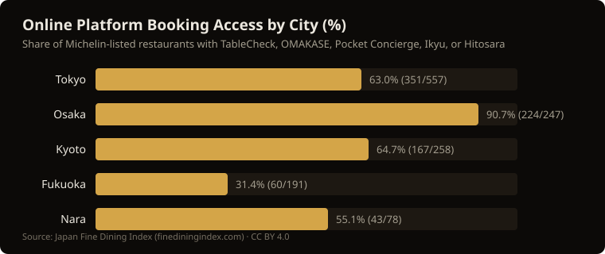
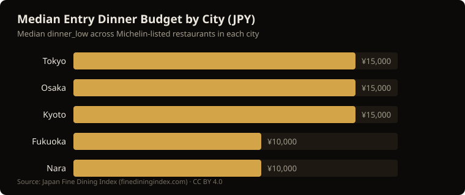

# Japan Fine Dining Open Dataset

Aggregate, machine-readable statistics covering **1331 Michelin-recognized restaurants** across Tokyo, Osaka, Kyoto, Fukuoka, and Nara — maintained by **[Japan Fine Dining Index](https://finediningindex.com/)**.

- **Last updated**: `2026-11-27` (auto-synced monthly)
- **Primary site**: https://finediningindex.com/
- **2026 Booking Access Field Audit (108 venues)**: https://finediningindex.com/en/reports/booking-access-2026/ ([CSV](https://finediningindex.com/reports/booking-access-2026.csv))
- **License**: CC BY 4.0 (aggregate tables & charts)

## Key Findings at a Glance

- **63.5% (845/1331)** have an identifiable online reservation platform (`TableCheck`, `OMAKASE`, `Pocket Concierge`, `Ikyu`, or `Hitosara`).
- **779** venues link to a verified official website.
- **Median entry dinner budget** across all listed venues: **¥15,000**.





## City Summary

| City | Restaurants | Stars (3★/2★/1★) | Online Bookable | TableCheck | OMAKASE | Ikyu | Median Dinner (JPY) |
|---|---:|---:|---:|---:|---:|---:|---:|
| Tokyo | 557 | 11/26/119 | 351 (63.0%) | 133 | 107 | 217 | ¥15,000 |
| Osaka | 247 | 3/12/66 | 224 (90.7%) | 65 | 41 | 121 | ¥15,000 |
| Kyoto | 258 | 6/19/72 | 167 (64.7%) | 48 | 18 | 140 | ¥15,000 |
| Fukuoka | 191 | 2/7/29 | 60 (31.4%) | 13 | 5 | 52 | ¥10,000 |
| Nara | 78 | 0/4/18 | 43 (55.1%) | 20 | 3 | 31 | ¥10,000 |
| **Total** | 1331 | 22/68/304 | 845 (63.5%) | 279 | 174 | 561 | ¥15,000 |

## Breakdown by Michelin Distinction

| Michelin Tier | Restaurants | Online Bookable | Official Site | Median Dinner (JPY) | Median Lunch (JPY) |
|---|---:|---:|---:|---:|---:|
| Three Stars | 22 | 21 (95.5%) | 20 | ¥50,000 | ¥25,000 |
| Two Stars | 68 | 60 (88.2%) | 59 | ¥30,000 | ¥15,000 |
| One Star | 304 | 254 (83.6%) | 207 | ¥20,000 | ¥10,000 |
| Bib Gourmand | 266 | 96 (36.1%) | 124 | ¥6,000 | ¥2,000 |
| Michelin Selected | 671 | 414 (61.7%) | 369 | ¥15,000 | ¥8,000 |

## Files in This Repository

- `data/city_summary.csv` & `data/city_summary.json` — City-level counts, star tiers, booking platforms, and JPY medians.
- `data/booking_access_by_tier.csv` — Online reservation availability and budget bands by Michelin tier.
- `data/cuisine_price_benchmarks.csv` — City × cuisine (≥5 venues) price & booking benchmarks.
- `cards/*.svg` — Lightweight dark-gold SVG charts.

## City Guides & Curated Rankings on Fine Dining Index

- [Tokyo](https://finediningindex.com/en/tokyo/) · [Best Sushi Omakase Tokyo](https://finediningindex.com/en/rankings/best-sushi-omakase-tokyo/) · [Hardest-to-Book Tokyo](https://finediningindex.com/en/rankings/hardest-to-book-tokyo/)
- [Osaka](https://finediningindex.com/en/osaka/) · [Best Sushi Omakase Osaka](https://finediningindex.com/en/rankings/best-sushi-omakase-osaka/) · [Online-Bookable Osaka](https://finediningindex.com/en/rankings/online-bookable-michelin-osaka/)
- [Kyoto](https://finediningindex.com/en/kyoto/) · [Best Kaiseki Kyoto](https://finediningindex.com/en/rankings/best-kaiseki-restaurants-kyoto/)
- [Fukuoka](https://finediningindex.com/en/fukuoka/) · [Best Sushi Omakase Fukuoka](https://finediningindex.com/en/rankings/best-sushi-omakase-fukuoka/)
- [Nara](https://finediningindex.com/en/nara/) · [Best Kaiseki Nara](https://finediningindex.com/en/rankings/best-kaiseki-restaurants-nara/)
- [How to Book Omakase in Japan](https://finediningindex.com/en/guides/how-to-book-omakase-in-japan/) · [Methodology](https://finediningindex.com/en/methodology/)

## Citation

```markdown
Japan Fine Dining Index (2026). *Japan Fine Dining Open Dataset* (updated 2026-11-27). https://github.com/zljsjp/japan-fine-dining-open-data · https://finediningindex.com/
```
